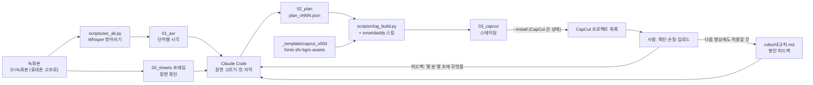

# EUITAE · 클로드 영상편집

**유튜브 채널 「의태」 브이로그 녹화본을 Whisper로 받아쓰고 Claude Code가 장면을 골라, 자막·강조 글자·효과음·배경음악까지 들어간 CapCut 초벌 프로젝트로 만드는 작업 저장소.**


## 전체 흐름



## 현재 상태

| 단계 | 내용 | 상태 |
|---|---|---|
| 환경 | 스마트대디 편집 스킬, Python 3.12, ffmpeg, faster-whisper 설치. 패키지 버전 고정 | ✅ 완료 |
| 받아쓰기 | 11/8 녹화본 36개, 약 69분 | ✅ 완료 |
| 초벌 v001 | 13:34 · 클립 82 · 자막 246 | ✅ 완료 |
| v002 | 운동 → 점심 → 낚시 → 컵라면 순서, 자막 줄임 | ✅ 완료 |
| v003·v004 | 첫 30초 하이라이트, 자막 0.45, 강조 글자 검은고딕 | ✅ 완료 |
| v005 | 하이라이트 낚시 먼저, 말 더듬기 삭제, 효과음 | ✅ 완료 |
| v006 | 하이라이트 띠·라벨, 운동 세트 정리 | ✅ 완료 |
| v007 | 의태 세트 복구, 원인 → 결과 순서, 설명 글자, 감성돔 사진 | ✅ 완료 |
| v008 | 하이라이트 끝 장면 교체, 제목 글자 삭제, 속마음 하늘색 자막, 0~5:50 수정, 배경음악 | ✅ 완료 |
| v009 | CapCut이 클립 시작 위치를 0초로 바꾸던 문제 수정(클립마다 재료를 따로 만듦) | ✅ 완료 |
| **v010** | 마지막 피드백 전체: 자막 박스, 종목 글자 새 모양, 장면 전환 5곳, 배경음악 장면별 배치와 페이드, 설명·속마음 글자 → CapCut 등록(12:40) | ✅ 완료 |
| **v011** | 종목 글자 주황빛 빨강 박스, 자막 박스 더 진하게·크기 0.40, 첫 운동 곡 Gym Phonk → CapCut 등록(12:40) | ✅ 완료 |
| **v012** | 운동 종목 글자를 [대괄호] 흰 글씨로(박스 없음) → CapCut 등록(12:40) | ✅ 완료 |
| 검토 | 자막 표기는 사용자가 CapCut에서 직접 손질 | 🔄 대기 |
| 최종 점검 | 내보낸 영상을 스킬 `verify_render.py`로 점검 | ⏳ 예정 |

## 폴더 구조

✏️ = 작업자가 고치는 곳 · 🔒 = 건드리지 말 곳(생성물이거나 CapCut이 경로로 쓰는 것)

```
클로드 영상편집/                        저장소 루트
├─ README.md                      ✏️ 처음 보는 사람용 안내(이 파일)
├─ CHANGELOG.md                   ✏️ 버전별 변경 이력(무엇을 왜 바꿨는지)
├─ rules/내규칙.md                 ✏️ 편집 규칙 20줄(스킬 `내 규칙` 사본). 다음 영상에도 그대로 적용
├─ 작업노트.md                     ✏️ 작업 메모: 폴더 규칙, CapCut 템플릿, 이 PC의 Python 버전
├─ .gitignore                     ✏️ 저장소에 올리지 않을 생성물 목록
├─ sop/                           ✏️ 작업 절차서(아래 SOP 표)
├─ scripts/                       ✏️ 공용 스크립트(고치면 CHANGELOG에 기록)
│  ├─ asr_all.py                  녹화본 폴더 전체 받아쓰기
│  ├─ vlog_build.py               plan.json → CapCut 프로젝트 조립, --install로 등록
│  ├─ make_vlog_sfx.py            저작권 걱정 없는 합성 효과음 10개 만들기
│  ├─ make_highlight_frame.py     하이라이트 띠·라벨 PNG 만들기
│  ├─ words_in.py                 구간별 단어 시각 출력(컷 위치 잡기)
│  └─ asr_probe.py                받아쓰기 충돌 원인 점검
├─ fonts/                         🔒 글꼴(검은고딕, Gothic A1 Black + OFL 라이선스)
├─ bgm/                           🔒 배경음악(Pixabay, mp3는 git 제외) + CREDITS.md(출처)
├─ sfx/                           🔒 합성 효과음(wav는 git 제외, make_vlog_sfx.py로 다시 만듦)
├─ assets/                        🔒 하이라이트 띠 PNG, 감성돔 사진(git 제외)
├─ _template/capcut_v004/         🔒 조립에 쓰는 CapCut 템플릿(git 제외)
└─ 1108_낚시_등운동_브이로그/          프로젝트 1개 = 폴더 1개
   ├─ 02_plan/plan_v00N.json      ✏️ 편집 계획: 구간·자막·강조 글자·효과음·배경음악(v001~v012)
   ├─ 00_sheets/                  🔒 생성물: 장면 미리보기(git 제외)
   ├─ 01_asr/                     🔒 생성물: 받아쓰기·음성(git 제외)
   ├─ 03_capcut/                  🔒 생성물: CapCut 스테이징·SRT·타임라인·목록 백업(git 제외)
   ├─ 04_preview/                 🔒 생성물: 확인용 미리보기(git 제외)
   └─ 03_build_log.txt            🔒 생성물: 마지막 조립 로그(git 제외)
```

> CapCut 프로젝트가 `fonts/`, `bgm/`, `sfx/`, `assets/` 안의 파일을 경로로 직접 쓴다. 폴더를 옮기면 CapCut에서 글꼴, 음악, 사진이 빠진다.

저장소 밖에 있지만 이 작업이 쓰는 것(모두 🔒):

| 위치 | 무엇 | 규칙 |
|---|---|---|
| `D:\녹화본` | 원본 영상 | 절대 고치지 않는다 |
| `~/.claude/skills/smartdaddy-video-edit` | 외부 편집 스킬(스마트대디 배포) | 저장소에 넣지 않는다. 피드백 규칙만 `references/rules.md`의 `내 규칙`에 쌓고, `rules/내규칙.md`로 복사한다 |

## 편집 규칙 한눈에 (자세한 내용은 [rules/내규칙.md](rules/내규칙.md))

| 영역 | 규칙 |
|---|---|
| 구성 | 첫 30초 하이라이트(낚시 → 운동 중 힘든 장면 → 가장 웃긴 장면) → 3초 검은 화면 → 본편(운동 → 낚시) → "오늘은 끝" |
| 비율 | 다음 영상부터 낚시:운동 = 7:3(적어도 6:4) |
| 운동 | 종목당 1~3세트, 의태 세트를 더 많이. 개수는 앞 1~5개와 마지막 3~5개만. 반응 대사 앞에는 그 동작을 넣는다 |
| 자막 | 흰 글씨 + 진한 검은 박스(0.85), 배율 0.40, 26자 이하, 조금 아래(y −0.82) |
| 화면 글자 | 운동 종목 = [종목] 흰 글씨, 대괄호만 주황빛 빨강, 박스 없음, 상황 설명 = 노란 검은고딕, 의태 속마음 = 하늘색, 작은 설명 = 물건 옆 |
| 장면 전환 | 장소가 바뀔 때 검은 화면 페이드 약 2.5초, 배경음악도 점점 작아지고 점점 커짐 |
| 금지 | 채널 이름이나 제목 글자, 노래 부르는 배경음악, 강조 글자마다 '뽀잉' 소리, 검은고딕에 없는 글자(…, ·, →) |
| 소리 | 합성 효과음 1분에 약 1.5개. 배경음악은 Pixabay의 Content ID 없는 곡(운동 스포츠 비트, 밥 우쿨렐레, 낚시 로파이, 라면 힙합) |

## SOP 목록

| 버전 | 작업 | SOP 파일 | 요청 예시 | 상태 |
|---|---|---|---|---|
| v0.1 | 환경 설치(스킬·Python·ffmpeg·Whisper) | [sop/SOP-01_환경설치.md](sop/SOP-01_환경설치.md) | "이 스킬 설치해 줘" | ✅ 완료 |
| v0.2 | 녹화본 받아쓰기·장면 미리보기 | [sop/SOP-02_받아쓰기.md](sop/SOP-02_받아쓰기.md) | "D:\녹화본 받아쓰기 돌려 줘" | ✅ 완료 |
| v0.3 | 브이로그 초벌 → CapCut 등록 | [sop/SOP-03_브이로그초벌.md](sop/SOP-03_브이로그초벌.md) | "의태 스타일로 편집해서 캡컷 프로젝트로 만들어 줘" | ✅ 완료 |
| v0.4~v0.8 | 피드백 수정(`_v002`~`_v007`) | SOP-03을 새 버전 plan으로 다시 실행 | "2분 50초에 등 찍은 장면 넣어 줘" | ✅ 완료 |
| v0.9 | 피드백 수정 + 배경음악(`_v008`, `_v009`) | SOP-03 (`bgm`, 속마음 `notes`) | "운동은 헬스 음악, 낚시는 분위기 맞는 브금" | ✅ 완료 |
| v1.0 | 마지막 피드백(`_v010`) | SOP-03 (`sub_box`, `cap_styles`, 장면 전환, 음악 페이드) | "장소 바뀔 때 검은 화면 페이드, 자막 박스로" | 🔄 종목 글자 모양 결정 대기 |
| — | 피드백을 규칙으로 저장 | 스킬 `references/feedback-loop.md` → `rules/내규칙.md` | "이것도 규칙에 저장해 줘" | ✅ 25줄 |

## 바로 쓰는 명령

```powershell
# 받아쓰기(SOP-02)
python -I scripts\asr_all.py "$HOME\.claude\skills\smartdaddy-video-edit\scripts" "D:\녹화본" ".\1108_낚시_등운동_브이로그\01_asr" large-v3-turbo

# 조립만(SOP-03) → 03_capcut 에 스테이징
python -I scripts\vlog_build.py "$HOME\.claude\skills\smartdaddy-video-edit\scripts" ".\1108_낚시_등운동_브이로그\02_plan\plan_v012.json"

# CapCut 등록(CapCut을 완전히 끈 뒤)
python -I scripts\vlog_build.py "$HOME\.claude\skills\smartdaddy-video-edit\scripts" ".\1108_낚시_등운동_브이로그\02_plan\plan_v012.json" --install

# 효과음·하이라이트 띠 다시 만들기
python -I scripts\make_vlog_sfx.py "$HOME\.claude\skills\smartdaddy-video-edit\scripts" ".\sfx"
python -I scripts\make_highlight_frame.py ".\assets\highlight_letterbox.png" ".\fonts\BlackHanSans-Regular.ttf"
```

`python`은 `%LOCALAPPDATA%\Programs\Python\Python312\python.exe`, ffmpeg는 winget 설치본이다. 이 PC는 Visual C++ 런타임이 오래돼서 패키지 버전을 고정해 두었다. 자세한 내용은 [작업노트.md](작업노트.md)와 [SOP-01](sop/SOP-01_환경설치.md)에 있다.

## 저장소에 올리지 않는 것

공개 저장소라서 다음은 `.gitignore`로 뺐다.
- 얼굴이 나오는 장면 미리보기와 사진
- 대화가 담긴 받아쓰기, 음성, 자막(SRT)
- CapCut 프로젝트와 템플릿 사본
- 배경음악, 효과음 같은 미디어 파일

모두 스크립트로 다시 만들거나 출처(`bgm/CREDITS.md`)에서 다시 받을 수 있다.
